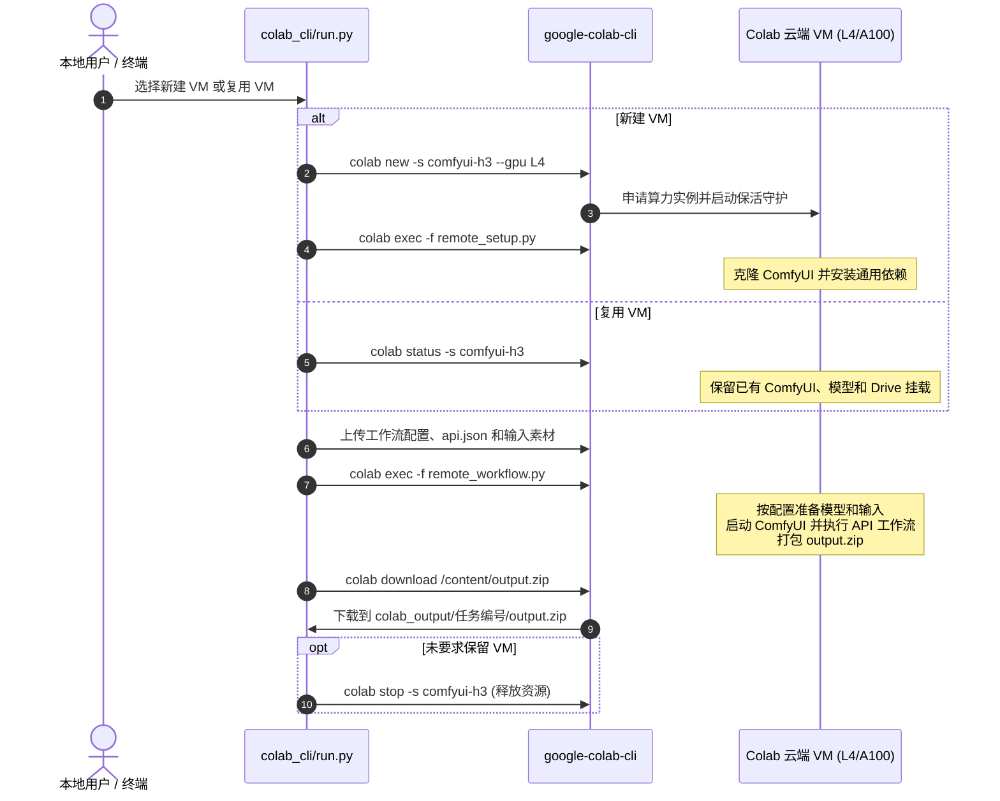

# Google Colab CLI (`google-colab-cli`) 详细使用指南

## INSO Wan2.2 Animate 14B

专用交互式入口：

```bash
cd colab_cli
./start_wan_animate.sh
```

使用 `UNETLoader` 测试 Wan Animate 2 BF16 权重：

```bash
./start_wan_animate_an2.sh
```

其 UNET 会优先复用或写入以下 Drive 缓存：

```text
MyDrive/code/backup/models/diffusion_models/wan_animate_2_bf16.safetensors
```

使用 Wan Animate 2 BF16 UNET 和原生 `LoraLoader` 串联版本：

```bash
./start_wan_animate_an2_lora.sh
```

该版本依次加载 `Wan2.2-big`、Relight、细节辅助和 LightX2V LoRA，
默认模型强度分别为 `0.70`、`0.85`、`0.60`、`1.00`，CLIP 强度均为 `0`。

也可以运行 `./start.sh`，然后选择
`inso_wan2_2_14.json`。建议使用 A100；该工作流不支持 TPU。

运行前分别放置工作流引用的参考图和源视频：

- 参考图：`colab_cli/image/78515578_109_5e22.jpg`
- 源视频：`colab_cli/video/打败敌人后要说一声对不起Lolita话题_走拍话题_转生小猫日记话题_女仆装话题.mp4`

公开来源明确的模型会自动下载并缓存到 Google Drive。工作流中的
`Wan2.2-big.safetensors` 无法从文件名唯一确认来源，必须手动放到：

```text
MyDrive/code/backup/models/loras/Wan2.2-big.safetensors
```

程序会在下载其他大模型之前检查此文件，缺失时直接报错。

输出会在远端打包并切成 16 MiB 分块。远端脚本保持运行，本地在 VM
结束前立即通过 Contents API 下载、重组，并执行分块 SHA-256、整包
SHA-256 和 ZIP CRC 校验；本地回传确认后，远端脚本才会退出。若
Contents API 临时不可用，程序会自动通过当前 Jupyter stdout 执行通道
兜底传输，不需要手动操作。

如果任务使用 `--keep` 或 `--reuse` 保留了 VM，也可以只重试兼容下载，
不会重新执行工作流：

```bash
python run.py --session <会话名称> --download-only
```

本文档全面整理了 `google-colab-cli` 的安装配置、核心命令、常用工作流、最佳实践与排错技巧，以及本目录下自动化脚本（ComfyUI / MiniMax H3 工作流）的运行机制。

---

## 目录

1. [核心特性与工作原理](#1-核心特性与工作原理)
2. [安装与认证配置](#2-安装与认证配置)
3. [命令速查与详细用法](#3-命令速查与详细用法)
   - [3.1 会话管理 (Session)](#31-会话管理-session)
   - [3.2 代码执行与交互 (Exec & REPL)](#32-代码执行与交互-exec--repl)
   - [3.3 一次性任务运行器 (colab run)](#33-一次性任务运行器-colab-run)
   - [3.4 文件操作与同步 (Files)](#34-文件操作与同步-files)
   - [3.5 环境配置与自动化 (Tools)](#35-环境配置与自动化-tools)
4. [高级用法与实战技巧](#4-高级用法与实战技巧)
5. [常见问题与踩坑排查 (FAQ)](#5-常见问题与踩坑排查-faq)
6. [本目录实战案例: MiniMax H3 工作流自动化](#6-本目录实战案例-minimax-h3-工作流自动化)

---

## 1. 核心特性与工作原理

`google-colab-cli` 是一个让你在本地终端无需打开浏览器即可管理并使用 Google Colab 云端计算资源的命令行工具。

* **多算力规格支持**：支持开箱即用的 CPU、GPU（`T4`, `L4`, `G4`, `H100`, `A100`）及 TPU（`v5e1`, `v6e1`）。
* **自动化保活 (Keep-Alive)**：内置独立的后台守护进程，自动对云端 VM 发送保活请求，避免因网页关闭或无操作导致实例被 Colab 释放。
* **本地与远端无缝衔接**：支持直接执行本地 Python 脚本、Jupyter Notebook (`.ipynb`)、管道输入流，无需手动反复上传代码。
* **一次性任务运行器 (`colab run`)**：自动申请 VM -> 执行脚本 -> 传回输出 -> 立即销毁 VM，适合 CI/CD 和自动化脚本。
* **完整的文件与环境管理**：基于 `uv` 极速安装依赖，支持双向文件传输、Drive 挂载、在线日志导出与浏览器会话回溯。

---

## 2. 安装与认证配置

### 2.1 安装方式

推荐使用 `uv` 独立工具链安装，也可以直接使用 `pip`：

```bash
# 推荐方式 (uv)
uv tool install google-colab-cli

# 或使用 pip
pip install google-colab-cli
```

> **注意**：目前 Colab CLI 主要支持 **Linux** 和 **macOS** 环境。

### 2.2 认证方式

Colab CLI 支持两种认证模式，通过全局参数 `--auth` 指定（默认为 `adc`）：

#### 方式 A: OAuth2 网页授权模式 (`--auth=oauth2`)
首次运行时会自动调起本地浏览器完成 Google 账号授权：
```bash
colab --auth=oauth2 new -s my-session
```
* 授权凭据将保存在本地 `~/.config/colab-cli/token.json`。
* 若在无头服务器/SSH 环境，需配合 client-oauth-config JSON 配置使用。

#### 方式 B: ADC 模式 (`--auth=adc`，推荐用于自动化/脚本)
对于无头服务器、Agent 或脚本自动化环境，使用 `gcloud` Application Default Credentials 最为稳定可靠。需要配置全部 4 个关键 scope：

```bash
gcloud auth application-default login \
  --scopes=openid,\
https://www.googleapis.com/auth/cloud-platform,\
https://www.googleapis.com/auth/userinfo.email,\
https://www.googleapis.com/auth/colaboratory
```

> **为什么必须包含这 4 个 Scope？**
> * `userinfo.email`：用于访问 Colab 会话后台后端（否则报 `401 Unauthorized`）。
> * `colaboratory`：用于 RuntimeService 保活心跳 RPC（否则报 `403 Forbidden`）。
> * `openid` 与 `cloud-platform`：Google Cloud 客户端标准基础权限。

#### 验证认证状态
```bash
# 查看当前活跃会话（可快速验证认证是否有效）
colab sessions

# 查看当前认证的账号、Scope 列表及过期时间（排错利器）
colab whoami
```

---

## 3. 命令速查与详细用法

### 3.1 会话管理 (Session)

| 命令 | 说明 | 常用参数 |
| :--- | :--- | :--- |
| `colab new` | 创建新的计算实例 | `-s <名称>` 指定会话名<br>`--gpu <T4\|L4\|G4\|H100\|A100>`<br>`--tpu <v5e1\|v6e1>` |
| `colab sessions` | 列出当前所有活跃的会话 | 无 |
| `colab status` | 查看指定会话的硬件状态与空闲情况 | `-s <名称>` |
| `colab restart-kernel`| 重启云端 Jupyter 内核（保留已下载的文件） | `-s <名称>` |
| `colab stop` | 销毁云端 VM 并停止保活守护进程 | `-s <名称>` |
| `colab url` | 生成该会话在浏览器中打开的 Colab Web 链接 | `-s <名称>`<br>`--open`（自动打开浏览器） |

#### 示例
```bash
# 启动一台配备 L4 GPU (24GB 显存) 的会话，命名为 comfy-task
colab new -s comfy-task --gpu L4

# 启动一台配备 A100 GPU 的高端会话
colab new -s llm-train --gpu A100

# 查看状态
colab status -s comfy-task

# 任务完成后必须手动销毁，防止扣除计算单元
colab stop -s comfy-task
```

---

### 3.2 代码执行与交互 (Exec & REPL)

#### 1. 执行本地脚本 (`colab exec`)
`colab exec` 会直接在本地读取文件并发送到远端内核执行，**无需手动 `colab upload` 脚本**：

```bash
# 运行本地的 train.py 脚本
colab exec -s my-session -f train.py

# 运行本地 Jupyter Notebook (执行结果将保存到 demo_output.ipynb)
colab exec -s my-session -f demo.ipynb

# 管道传入代码执行
echo "import torch; print('CUDA可用:', torch.cuda.is_available())" | colab exec -s my-session

# 长时间任务（如下载大模型/训练）需指定超时时间（单位秒，传 0 或大数值避免默认 30s 超时）
colab exec -s my-session -f long_task.py --timeout 86400
```

#### 2. 保存输出图片 (`--output-image`)
当远端脚本产生 Matplotlib 图像或 PIL 图片时，可直接捕获到本地：
```bash
colab exec -s my-session -f plot.py --output-image ./result.png
```

#### 3. 交互式控制台与终端
```bash
# 交互式 Python REPL (管道传入 EOF 时会自动退出)
colab repl -s my-session

# 连接到远端真实的交互式 bash/tmux 终端
colab console -s my-session
```

---

### 3.3 一次性任务运行器 (`colab run`)

`colab run` 相当于将 `colab new` -> `colab exec` -> `colab stop` 串联为一条原子命令：
1. 自动根据参数申请对应硬件的 VM；
2. 自动注入命令行参数（通过 `sys.argv` 传递）；
3. 运行完毕后**自动销毁 VM**，防止意外烧计费；
4. 退出状态码（Exit Code）与本地 Python 进程完全保持一致。

```bash
# 在 T4 显卡上执行一次性脚本，跑完即释放
colab run --gpu T4 benchmark.py --batch-size 32

# 在 L4 显卡上运行，并保留 VM 供后续排查（--keep）
colab run --gpu L4 --keep -s debug-session test_model.py
```

#### 支持 Shebang 脚本写法
在脚本头部加上如下声明，赋予可执行权限后即可当作本地脚本直接运行：
```python
#!/usr/bin/env -S colab run --gpu L4
import torch

print("GPU 型号:", torch.cuda.get_device_name(0))
print("显存大小:", torch.cuda.get_device_properties(0).total_memory / 1024**3, "GB")
```
```bash
chmod +x check_gpu.py
./check_gpu.py
```

---

### 3.4 文件操作与同步 (Files)

> 💡 **重要**：Colab VM 的默认工作目录是 `/content`。在进行文件操作时，推荐显式使用绝对路径（如 `/content/data.zip`）。

| 命令 | 说明 | 示例 |
| :--- | :--- | :--- |
| `colab ls` | 查看远端目录文件 | `colab ls -s my-session /content` |
| `colab upload` | 上传本地文件到云端 | `colab upload -s my-session ./weights.pth /content/weights.pth` |
| `colab download` | 从云端下载文件到本地 | `colab download -s my-session /content/output.zip ./output.zip` |
| `colab rm` | 删除云端文件 | `colab rm -s my-session /content/temp.log` |
| `colab edit` | 使用本地 `$EDITOR` 编辑云端文件并同步回写 | `colab edit -s my-session /content/config.yaml` |

---

### 3.5 环境配置与自动化 (Tools)

#### 1. 快速安装依赖 (`colab install`)
远端会优先使用 `uv pip` 极速安装，秒级解析完成：
```bash
# 安装指定包
colab install -s my-session torch torchvision transformers diffusers

# 从 requirements.txt 安装
colab install -s my-session -r requirements.txt
```

#### 2. 挂载 Google Drive (`colab drivemount`)
```bash
# 默认挂载到 /content/drive
colab drivemount -s my-session
```

#### 3. 查看与导出日志 (`colab log`)
```bash
# 查看最近 30 条事件日志
colab log -s my-session -n 30

# 将当前会话历史导出为 Notebook / Markdown 文件
colab log -s my-session -o session_record.ipynb
colab log -s my-session -o session_record.md
```

#### 4. 打开额度充值页面
```bash
colab pay
```

---

## 4. 高级用法与实战技巧

### 4.1 显存（VRAM）与内存（RAM）的选择说明

* **关于系统内存（RAM）**：`colab new` 命令行目前**不提供**独立的 `--ram` 或 `--high-ram` 参数。
* **配置规则**：系统内存大小随硬件规格联动分配。
  * **T4**：标准系统内存（约 12.7 GB RAM）。
  * **L4 / A100**：通常会自动分配 **High-RAM 高内存环境**（系统内存更大，且配有 24GB~80GB 大显存）。
* **大模型显存防爆策略**：运行 30GB+ 大模型时，可在脚本中结合 ComfyUI / PyTorch 的显存优化参数（例如 `--lowvram`、`--reserve-vram` 或 `torch.cuda.empty_cache()`）。

### 4.2 区分 CLI 鉴权 与 `colab auth`

* **CLI 鉴权**（`gcloud auth` 或 `--auth=oauth2`）：控制本地电脑是否有权限管理 Colab 虚拟机。
* **`colab auth` 命令**：为**云端 VM 内部**的 Python 运行时注入 Google Cloud 凭证（例如在 Notebook 里访问 BigQuery 或 GCS 存储桶）。

### 4.3 隔离并行任务配置
如果有多个自动化脚本或 Agent 并发运行，可以通过 `--config` 指定独立的会话状态文件，防止状态覆盖：
```bash
colab --config /tmp/session_worker1.json new -s worker-1 --gpu L4
colab --config /tmp/session_worker2.json new -s worker-2 --gpu A100
```

---

## 5. 常见问题与踩坑排查 (FAQ)

### Q1: 运行 `colab new` 报 `403 Forbidden` 或保活进程退出？
* **原因**：认证凭据中缺少 `https://www.googleapis.com/auth/colaboratory` 作用域。
* **解决**：运行 `colab whoami` 检查 scopes，按[2.2 小节](#方式-b-adc-模式-authadc推荐用于自动化脚本)使用 `gcloud` 重新登录并传入 4 个 scope。

### Q2: 申请 A100 / L4 报错 `400 Bad Request` 或 `ResourceExhausted`？
* **原因**：账号当前层级没有对应的计算单元（Compute Units）或该区域此类 GPU 暂时缺货。
* **解决**：运行 `colab pay` 检查计算单元余额，或降级使用 `--gpu T4` 或 CPU。

### Q3: 为什么 `colab repl` 或 `colab console` 在脚本中卡死？
* **原因**：这两个命令设计用于人类交互，需要 TTY 终端。
* **解决**：在自动化脚本中，统一使用 `colab exec -s <name> -f <file.py>` 或通过管道 `echo "..." | colab exec -s <name>`。

### Q4: 提示 `Session not found`？
* **原因**：远端 VM 可能因空闲超时或云端资源回收被释放。
* **解决**：运行 `colab sessions` 查看当前有效会话，必要时重新 `colab new`。

---

## 6. 本目录实战案例: MiniMax H3 工作流自动化

本目录包含一套配置驱动的 ComfyUI 工作流调度器，MiniMax H3 是默认工作流：

```
colab_cli/
├── start.sh                    # 交互选择工作流和运行配置
├── stop.sh                     # 交互停止会话
├── set_frames.py               # 一键设置首帧/尾帧输入图片
├── run.py                      # VM 生命周期、配置/输入上传、结果下载
├── remote_setup.py             # 仅安装通用 ComfyUI 环境
├── remote_workflow.py          # 配置驱动的模型准备和工作流执行器
└── workflows/
    └── minimax_h3.json         # MiniMax H3 API、输入规则和模型清单
```

### 设置输入图片

运行前先用 `set_frames.py` 指定输入图片，它会自动把图片复制到
`image/` 目录（同名不同内容自动加序号后缀），并在 `api.json` 中追踪
`MiniMaxH3ImageToVideo` 节点的帧输入，更新对应 `LoadImage` 节点引用的
文件名：

仓库根 `api.json` 已接首帧（节点 114）和尾帧（节点 122）：

```bash
python3 colab_cli/set_frames.py --first 首帧.png
python3 colab_cli/set_frames.py --first 首帧.png --last 尾帧.png
```

未接线的工作流会被明确拒绝。

之后正常 `./start.sh` 选择 `minimax_h3.json` 即可，输入图片会随工作流
自动上传。

### 运行流程



### 常用运行命令

```bash
# 交互式启动（每次选择工作流、新建/复用 VM、GPU/TPU、Drive 缓存等）
./colab_cli/start.sh

# 交互式停止指定会话
./colab_cli/stop.sh

# 1. 默认运行: 自动挂载 Google Drive, 优先从 code/backup/models/ 复用 39GB 模型
python colab_cli/run.py --gpu L4

# 2. 在 A100 (40GB/80GB 显存) 上运行
python colab_cli/run.py --gpu A100

# 3. 不挂载 Google Drive (纯 VM 临时下载)
python colab_cli/run.py --gpu L4 --no-mount-drive

# 3.1 显式选择模型获取方式（download | symlink | copy；默认 auto）
python colab_cli/run.py --gpu L4 --model-mode download

# 4. 调试模式: 跑完不销毁 VM，方便排查
python colab_cli/run.py --gpu L4 --keep

# 5. 复用仍在运行的会话，跳过创建 VM 和 ComfyUI 通用安装；任务后继续保留 VM
python colab_cli/run.py --session comfyui-h3 --reuse

# 6. 手动销毁会话
python colab_cli/run.py --stop

# 7. 直接选择另一个工作流配置
python colab_cli/run.py --workflow-config colab_cli/workflows/example.json --gpu L4

# 8. 为已经适配 PyTorch/XLA 或 JAX 的工作流申请 TPU
python colab_cli/run.py --workflow-config colab_cli/workflows/tpu_example.json --tpu v6e1
```

需要连续提交任务时，第一次使用新建模式并选择保留 VM；之后再次运行 `start.sh`，选择同一会话的复用模式即可。复用模式会重新上传本次 API 工作流和输入素材，但不会再次运行 `remote_setup.py`，任务结束后也不会自动关闭 VM。复用时只检测 Google Drive 是否已经挂载，不会调用 `drive.mount()` 或再次触发认证；如果挂载已经失效，则自动改用 VM 本地模型。全部任务结束后使用 `stop.sh` 释放资源。

云端 `/content/output` 会在每次推理前重建，因此压缩包只包含当前任务的结果。本地结果按唯一任务编号保存到 `colab_output/<任务编号>/output.zip`，不会覆盖上一次下载。

推理期间的资源监控会在后台每秒采集一次 NVIDIA GPU 使用率，交互式终端每 2 秒刷新资源栏，非交互式日志每 5 秒输出服务器状态。GPU 状态同时显示当前值、最近 30 秒平均值和峰值，避免 ComfyUI 步骤间隙的瞬时 `0%` 造成误判。

MiniMax H3 当前只支持 GPU。ComfyUI 的设备管理没有 PyTorch/XLA 后端，MiniMax H3 节点及相关算子也以 CUDA/PyTorch 为目标，因此选择 TPU 会在创建 VM 前被兼容性校验阻止。真正的 TPU 工作流需要单独适配 `torch_xla` 或 JAX、移除 CUDA 专用算子并提供相应执行器；不能只把配置中的支持类型改成 `tpu`。

### 新增其他工作流

在 `colab_cli/workflows/` 中增加一个 JSON 文件即可出现在 `start.sh` 菜单中。配置字段：

- `name`：运行日志中的工作流名称；
- `api_json`：相对配置文件所在目录或绝对路径；
- `supported_accelerators`：工作流实际支持的加速器类型，可选值为 `gpu`、`tpu`、`cpu`；省略时默认为 `gpu`；
- `accelerator_note`：选择不兼容加速器时显示的工作流专属说明；
- `input_fields`：需要从 API 工作流读取并上传的输入节点字段；
- `editable_fields`：任务提交页允许覆盖的 API 节点输入白名单；可按唯一
  `class_type` 或明确的 `node_id` 定位节点，MiniMax H3 用它暴露视频 prompt；
- `models`：模型的 Hugging Face 仓库、仓库内文件、ComfyUI 模型目录、Drive 缓存路径及可选精确大小；
- `comfy_flags`：该工作流专属的 ComfyUI 启动参数。

无需模型的工作流可将 `models` 设置为空列表。通用安装逻辑无需复制或修改。

### Google Drive 模型缓存与 VM 本地加载

Colab 工作流默认优先持久保存到 Google Drive，再使用 VM 本地副本加载模型：

1. **确认挂载**：执行器检查 `/content/drive` 是否真实挂载且 `MyDrive` 可访问，
   不主动触发认证。通过临时写入确认模型目录可写；只读 Drive 中的已有模型仍能复用。
2. **直接下载到 Drive**：缺失模型通过 Hugging Face `local_dir` 下载到
   `MyDrive/code/backup/models/.downloads/<模型标识>/<VM 标识>/`。
   下载进程的 HF/Xet 缓存也指向该目录，不先在 VM 默认缓存留下完整权重。
3. **校验后归档**：下载完成后按配置的 `size_bytes` 校验，再将完整文件归档到
   `MyDrive/code/backup/models/<cache_path>`。中间文件不作为有效模型；同一 VM
   重试复用下载目录，不同 VM 使用各自的中间目录，VM 内通过本地文件锁避免重复下载。
4. **按任务选择加载方式**：提交时可指定 `model_mode`（`auto`、`download`、`symlink`、`copy`，默认 `auto`）：
   - `download`：Hugging Face 直接下载到 VM 本地，不读写 Drive 缓存；无下载源的手动模型仍从 Drive 软链。
   - `symlink`：Drive 缓存直接软链到 ComfyUI 目录，省磁盘和复制时间，推理时直读挂载盘。
   - `copy`：Drive 缓存复制到 VM 本地，推理加载最快；本地空间不足时回退 Drive 软链。
   - `auto`：Colab 使用 `copy`，Modal/Kaggle 沿用各自原有策略（软链接）。
5. **明确回退**：Drive 未挂载、不可写或出现配额/存储错误时，先确认 VM 剩余空间，
   再本地下载，并为 ComfyUI/产物保留至少 2 GiB。未声明大小时先查询远端文件大小。
   网络、仓库权限和下载内容校验失败会直接报错，不换目录重复下载。

以上模式同样支持 Modal Volume 和 Kaggle Dataset，后两者检查映射的模型缓存目录，
不依赖 Colab 的 Drive 挂载点。`copy` 在所有后端均支持空间不足时回退软链接。
复用 VM 后选择 `symlink` 会把已有本地副本切换为缓存链接；缓存缺失但可写时，
直接归档已有完整副本，无需重新下载。缓存不可用时保留已有可用的 VM 文件，
并在日志中说明回退原因；模式切换失败不会提前删除原模型。
Web 提交页可选择模型获取方式；CLI 使用 `--model-mode download|symlink|copy`，
不传时保持 `auto` 原有行为。

## 可靠性相关环境变量（Runner / colab_core）

| 变量 | 缺省 | 说明 |
| :--- | :--- | :--- |
| `COLAB_SESSION_QUEUE_MAX` | 5 | 同一会话的 FIFO 排队上限（不含运行中的那个）；0 = 禁用排队，恢复 409 SESSION_BUSY |
| `COLAB_RETRY_ATTEMPTS` | 3 | 上传 / 环境安装 / 产物下载遇瞬时故障的最大尝试次数 |
| `COLAB_RETRY_BASE_SECONDS` | 5 | 指数退避首次等待秒数（封顶 60s） |
| `COLAB_REATTACH_TIMEOUT` | 1800 | 执行阶段断线后等待远端完成的最长秒数；0 = 不重连 |
| `COLAB_REATTACH_POLL_SECONDS` | 30 | 重连期间轮询远端产物清单的间隔 |

提交任务时请求体可带 `"queue": false`，同会话忙时直接返回 409 而不排队。

Runner 会在工作线程退出时补齐缺失的终态。失败或取消后若保留了 VM，
同会话的等待任务会以 `SESSION_RECOVERY_REQUIRED` 结束，避免覆盖远端结果；
处理结果后可停止会话，或明确提交 `reuse=true` 的新任务。成功保留 VM 时，
仅自动提升明确开启复用的排队任务。保留会话的保护记录以及重启后的
`interrupted` 记录会持续落盘，直到明确处理，不会在第二次重启时消失。

`GET /sessions` 的成功快照缓存 5 秒，并合并同时到达的查询。云端列表查询
超时为 5 秒，仅对云端确认存活的会话并发补查状态（最多 4 路，共 3 秒预算）。
云端查询失败或无法解析时返回 HTTP 503 / `SESSION_QUERY_FAILED`，客户端应
保留已有状态；只有有效的云端列表才可用于判断 VM 是否消失。

普通阶段的恢复状态最多每秒合并写入一次，任务受理、启动、终态、重新下载、
会话交接和服务关闭仍即时保存；事件里程碑继续逐条 fsync。已结束的普通档案
在内存最多保留 128 个，历史查询与重取结果可从磁盘恢复。SSE 消费积压时会
真正关闭连接，客户端使用最后已处理的 seq 重连补拉持久化事件。

## Docker 一键启动（Web + Runner，复用已有 MySQL）

Compose 只启动 `web` 和 `runner`，数据库、JWT、管理员及 FTP 配置直接读取
`web/.env`。先确认 `NUXT_DB_HOST` 是容器能访问的 MySQL 地址：可以填宿主局域网
IP（如 `192.168.1.25`）或 `host.docker.internal`，不能填容器自身的 `127.0.0.1`。
MySQL 需允许该数据库用户从 Docker 网络连接。

在 `colab_cli` 目录运行：

```bash
mkdir -p secrets/colab
docker compose --env-file web/.env up -d --build
docker compose --env-file web/.env ps       # web、runner 都应为 healthy
```

Web 宿主端口沿用 `web/.env` 的 `NITRO_PORT`（缺省 `54471`），监听地址沿用
`NITRO_HOST`（缺省 `127.0.0.1`）。容器内部固定为 `3000`，Runner 无宿主端口。
例如 `NITRO_PORT=54471` 时访问 `http://127.0.0.1:54471`，Web 账号密码使用
现有数据库里的账号；`NUXT_ADMIN_*` 只在首次管理员迁移时生效。

Web 启动时执行未完成的数据库迁移；Compose 默认关闭开发用的
`NUXT_DB_SYNCHRONIZE` 和数据库 SQL 日志，本地 `web/.env` 不受影响。
两个容器以 UID/GID 1000 共享 `/data/colab_output` 产物卷，支持读取和清理产物。
工作流和输入图片通过仓库父目录挂载到 `/srv`，兼容旧版 MiniMax 的
`../../api.json` 引用；Web 与 Runner 共享修改后的工作流、图片及
`/data/colab_uploads` 临时上传目录，支持提交任务页上传首尾帧。

**Colab 认证在终端输入**，Web 登录页用于登录控制台账号。首次认证执行：

```bash
docker compose --env-file web/.env exec runner colab --auth=oauth2 sessions
```

终端打印 Google 授权链接。在浏览器打开链接，登录 Google 并同意授权，将显示的
授权码粘贴回终端的 `Enter the authorization code:` 提示，然后回车。
凭据保存在宿主 `secrets/colab/token.json`，挂载到容器
`/home/runner/.config/colab-cli/token.json`，重启容器后仍保留。
该版本 CLI 没有 `colab auth login` 子命令。

已在宿主登录过，可在首次使用前复制凭据：

```bash
install -m 600 ~/.config/colab-cli/token.json secrets/colab/token.json
```

`secrets/` 已被 Git 和 Docker 构建上下文忽略。凭据目录须允许 UID 1000 读写，
以便刷新 OAuth 令牌。

可选配置见 `.env.docker.example`，复制为 `.env.docker` 后，所有命令改用
`docker compose --env-file web/.env --env-file .env.docker ...`。
例如 `COLAB_AUTH_DIR` 可指定已有凭据目录，`WEB_PORT` / `WEB_BIND` 可覆盖宿主端口
和监听地址；HTTP 默认 `AUTH_COOKIE_SECURE=false`，HTTPS 反代时设为 `true`。
Kaggle / Modal 凭据也写入该文件，并设 `INSTALL_BACKENDS=1` 后重新构建。

若宿主能联网而 Docker 容器不能，在 `.env.docker` 设置容器可访问的
`DOCKER_HTTP_PROXY`，构建与运行都会使用它；`DOCKER_NO_PROXY` 中加入数据库、FTP
等内网地址及 `runner`，避免内部服务经过代理。

查看日志：`docker compose --env-file web/.env logs -f`；
停止：`docker compose --env-file web/.env down`。`down -v` 会删除产物及 Runner 状态卷。
